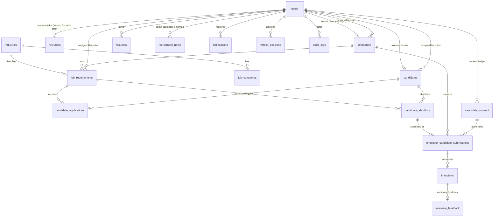

# Veejee Services – Architecture

## System overview

```
Browser (Angular 22 SPA, Bootstrap 5)
   │  HTTPS, same origin  (https://ananth-careers.vercel.app → custom domain later)
   ▼
Vercel ── static SPA + SPA fallback
   │  rewrite /api/*  →
   ▼
Render – Node 24 + Express 5 API (/api/v1, /health, /api/docs)
   ├── MongoDB Atlas  (replica set → transactions, TTL, text search)
   ├── S3-compatible object storage (resumes, photos, logos – AES-256-GCM encrypted by the API)
   ├── SMTP via durable email_outbox queue + retry worker
   └── Scheduler (interview reminders, profile-completion reminders – idempotent, multi-instance safe)
```

PostgreSQL (Aiven) is **not used**. Every record lives in MongoDB, so nothing is duplicated across two databases.

## Recruitment workflow (consultancy model)

```
Candidate registers ─► verifies email ─► completes profile + resume      (stage: registered → profile_incomplete → profile_completed)
        │  applies to a published requirement (optional) → candidate_applications (Veejee Services only)
        ▼
Recruiter screens ─► under_review / screening ─► filters database / runs matching for a requirement
        ▼
Shortlist (candidate_shortlists) ─► management approval (configurable) ─► approved          (stage: shortlisted)
        ▼  candidate consent check (profile_sharing, optional contact_sharing) – recorded in candidate_consent
Submission to company (employer_candidate_submissions)                                       (stage: submitted)
        ▼
Company reviews ─► accept / reject / on hold / request interview                             (company_reviewing / interview_requested)
        ▼
Veejee Services schedules interview (interviews) ─► reminder ─► company feedback (interview_feedback)
        ▼                                                                                    (interview_scheduled → interview_completed)
Selected ─► Veejee Services confirms placement + joining date                                (selected → placed)
```

- **Stage derivation:** a candidate's overall stage comes from all of their shortlists and submissions (`recruitment.shared.ts › recomputeStage`). A rejection by one company never hides progress with another.
- **Recruiter-set stages:** recruiters can directly set only `under_review`, `screening`, `on_hold`, `rejected` and `profile_completed`. Every other stage follows from workflow actions.
- **History:** every change is stored in `stageHistory` and `statusHistory` with the actor, time and note. A `visibleToCandidate` flag separates candidate-safe notes from internal ones. Internal recruiter notes live in `recruitment_notes` and are never returned to candidates or companies.

## Matching engine (`services/matching.service.ts`)

The score is a weighted average of six factors. Admins configure the weights in **System Settings**; the defaults are skills 40, experience 20, education 10, location 15, salary 10, notice period 5.

| Factor | How it is scored |
|---|---|
| Skills | Share of the required skills the candidate has. Matching is case-insensitive and allows partial matches. Missing skills are listed |
| Experience | Inside the min–max range scores 1. Below the minimum is scaled down. Above the maximum scores 0.75 ("may be over-qualified") |
| Education | The required qualification matches the candidate's qualification or specialisation |
| Location | Remote role, a preferred city, a home city, or "anywhere" scores 1. The same state scores 0.6. Otherwise 0 |
| Salary | Expected salary (converted to yearly) within budget scores 1, decreasing with the gap. Not disclosed scores a neutral 0.7 |
| Notice period | Within the requirement's limit scores 1, decreasing beyond it. Unknown scores a neutral 0.7 |

Each factor returns a plain-language reason. The score only **ranks** candidates for recruiter review. It never filters anyone out of the database and never makes a decision.

## Backend layers (`backend/src`)

| Layer | Location |
|---|---|
| Config | `config/env.ts` (Zod-validated, fails fast) · `config/db.ts` (retry/back-off) |
| Routes and controllers | `modules/*/*.routes.ts`. `ApiRouter.route()` handles auth, roles and permissions, Zod validation, uploads, the response envelope and OpenAPI registration |
| Services (business logic, data access) | `modules/*/*.service.ts`, `services/*` (pipeline, matching, scheduler, email, storage, activity) |
| Models | `models/*.ts`: schemas, validation, indexes, safe serialisation |
| Cross-cutting | `middleware/*` (auth, security, uploads, errors) · `common/*` (constants, validation, crypto, http) |

Modules: `auth`, `users`, `candidates` (candidate portal), `resumes`, `jobs` (requirements and public job opportunities), `employers` (company profiles), `employer-portal`, `recruitment` (recruiter portal: candidates, matching, shortlists, submissions, interviews), `admin`, `taxonomy`, `public`.

## Database (MongoDB) – collections and relationships



| Collection | Key fields | Notes / indexes |
|---|---|---|
| `users` | email (unique), mobile, passwordHash (Argon2id, hidden), role, status, permissions[], lockout fields, consent{} | |
| `candidates` | user, careerLevel, **skills[] / education[] / experience[] embedded**, salaries, preferredRoles / locations / workModes / industries, employmentTypes, noticePeriodDays, availability, primaryResume, consent{profileSharing, contactSharing}, **stage + stageHistory**, assignedRecruiter, profileCompletion | Weighted text index. Indexes on skills.name, stage, assignedRecruiter, careerLevel + experience, locations, notice, completion |
| `candidate_consent` | candidate, type (profile_sharing / contact_sharing), granted, version, ip, userAgent | Append-only ledger (DPDP) |
| `resumes` | owner, storageKey (hidden, encrypted file), originalName, isPrimary | |
| `companies` | owner, companyName, slug, industry, registrationNumber, verificationStatus, accountManager, logoKey | |
| `recruiters` | user, employeeCode, designation, specializations[], active | Veejee Services staff |
| `job_requirements` | title, description, skills, qualifications, openings (vacancies), experience, salary, locations, workMode, employmentType, noticePeriodMaxDays, confidential, assignedRecruiter, status, filledCount | Text index. Status, industry, employer and recruiter indexes |
| `candidate_applications` | job, candidate, candidateProfile, resume, status, statusHistory | Unique (job, candidate) |
| `candidate_shortlists` | job, candidate, match{score, factors}, status, shortlistedBy, reviewedBy | Unique (job, candidate) |
| `employer_candidate_submissions` | job, employer, candidate, shortlist, resume, consentRecord, contactShared, recruiterSummary, status, statusHistory[visibleToCandidate], interviewRequest, joiningDate, placedAt | Unique (job, candidate) |
| `interviews` | submission, round, scheduledAt, mode, location / meetingLink, status, candidateResponse, reminderSentAt | Scheduled by Veejee Services |
| `interview_feedback` | interview (unique), submission, rating, feedback, recommendation | From the company |
| `recruitment_notes` | candidate, job, author, kind (note / communication / system), body | Internal only |
| `platform_settings` | matchingWeights, requireShortlistApproval, reminders, notifications | Singleton |
| `notifications`, `contact_enquiries`, `audit_logs`, `refresh_sessions`, `email_verification_tokens`, `password_reset_tokens`, `email_outbox`, `site_contents`, `testimonials`, `industries`, `job_categories` | | TTL indexes on tokens, sessions, notifications and sent email |

**Why education, skills and experience are embedded** (rather than kept in separate `candidate_education`, `candidate_experience` and `candidate_skills` collections):
- the candidate filters and the matching engine read them on every search, and embedding avoids a multi-collection join for each candidate
- they are always read and written together with the candidate
- each list is small and bounded by validation (education ≤ 15, experience ≤ 30, skills ≤ 60)

**Transactions** wrap registration, applications, consent changes, submissions, interview scheduling and staff invitations.

## Payments (future module)

Designed, not implemented. The plan is `plans`, `subscriptions`, `payments` and `invoices` collections, plus a `modules/payments` module using Razorpay (orders, webhook signature verification, refunds). Card, CVV and bank data are never stored.
